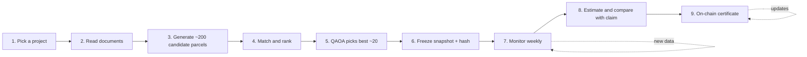

# Quantum-Enhanced Public Carbon Credit Verification

A public, independently checkable way to see whether a forest protection (REDD+) carbon credit project is delivering the impact it claims.

The repository finds "twin forests" to a reference project: unprotected land that looks like the project area before the project started. It then uses quantum optimisation to choose the best comparison set, measures forest loss in the project and in that set over time, and estimates what would have happened without the project.

> **Status:** early prototype built for the Hanken Quantum Hackathon. Candidate search exists in code. QAOA selection, monitoring, estimation and the on-chain certificate are designed but not built. Sections below say which is which.

## Contents

1. [The problem](#the-problem)
2. [The idea](#the-idea)
3. [Pipeline](#pipeline)
4. [How the pieces work](#how-the-pieces-work)
5. [Design principles](#design-principles)
6. [Open research questions](#open-research-questions)
7. [Current status](#current-status)
8. [Running the code](#running-the-code)
9. [Limitations](#limitations)
10. [Roadmap](#roadmap)

## The problem

Satellite-based rating platforms such as Sylvera, Pachama and BeZero already monitor carbon credit projects, and Verra now sets REDD+ baselines itself (methodology VM0048). What is still missing is a public record. A project's current status sits inside paid dashboards, and a company can choose not to share an unfavorable result.

## The idea

- Compare a registered project against similar, unprotected land nearby, using real satellite data.
- Use quantum computing to select the best comparison parcels and estimate what would have happened without the project.
- Publish the result as an on-chain certificate (NFT) that updates as new satellite data arrives, so anyone can check it.

The comparison land is required, not optional. Avoided deforestation only has meaning relative to what would have happened anyway, so a project's claimed impact cannot be checked without a stand-in for that hypothetical.

The core test is simple. If the comparison parcels lose forest and the project does not, the project is likely protecting it. If both lose about the same, it is not.

## Pipeline



| Step | What it does | Status |
| --- | --- | --- |
| 1. Pick a project | Take a registered project's boundary and claimed impact | Manual (KML file) |
| 2. Read documents | AI extracts the claimed baseline and tonnage from public project documents | Not built |
| 3. Generate candidates | Create comparison parcels around the project, with a buffer zone excluded to limit leakage | Partly built (grid of cells, no buffer yet) |
| 4. Match | Rank candidates by similarity to the project, using only information the outcome could not have influenced | Partly built (see [limitations](#limitations)) |
| 5. Select | Quantum optimization (QAOA) picks the best set of parcels, balancing similarity and geographic spread | Not built |
| 6. Freeze | Save the chosen parcels and settings as a hashed snapshot so they cannot be swapped later | Not built |
| 7. Measure | Satellite forest loss for the project and the chosen parcels since project start, monitored weekly | Not built |
| 8. Estimate | Quantum amplitude estimation gives the expected loss without the project, with a confidence interval; convert to tons of CO2 and compare with the project's claim | Not built |
| 9. Certificate | Record the result on-chain, publicly and permanently | Not built |

## How the pieces work

### Data

All geospatial data comes from Google Earth Engine.

| Layer | Dataset | Used for |
| --- | --- | --- |
| Tree cover, year 2000 | Hansen Global Forest Change (`UMD/hansen/global_forest_change_2025_v1_13`, band `treecover2000`) | Biomass proxy for matching |
| Forest loss year | Hansen Global Forest Change, band `lossyear` | Deforestation history and annual loss measurement |
| Elevation | SRTM (`USGS/SRTMGL1_003`) | Matching (current code) |
| Satellite embeddings | An Earth Engine satellite embedding dataset (64 numbers per location) | Matching (planned) |
| Road and nighttime-light accessibility | Road and nighttime-light layers (datasets not yet chosen) | Matching (planned) |
| Near-real-time alerts | A forest-disturbance alert layer such as GLAD or RADD (not yet chosen) | Weekly monitoring (planned) |

Hansen data updates about once a year, so it is the reference record. Alert layers update more often but are noisier, so they act as provisional early signals.

The current code matches on tree cover in 2000, past loss and elevation. The planned feature set replaces these with the satellite embedding plus road and nighttime-light accessibility. All features must describe the land as it was before the project started.

### Candidate generation and matching (`parcel_finder.py`)

`FindParcels` takes the project polygon and works in three stages:

1. **Search region.** A ring around the project: the project polygon buffered by 50 km, minus the project itself.
2. **Grid.** The ring is covered with 400 m grid cells, and each feature layer is averaged inside every cell.
3. **Score.** Each cell is compared with the project's average feature values. For each feature the absolute difference is divided by a tolerance (`max_diffs`) and capped at 1; the capped differences are averaged and turned into a 0 to 100 similarity score. The top `parcel_amount` cells (default 200) are returned.

### QAOA parcel selection (design, not yet implemented)

Choosing which parcels to keep is a subset-selection problem. Give each of the N candidates a binary variable `x_i` (1 means the parcel is picked) and pick exactly `K` of them. The objective rewards parcels that match the target well and sets that are spread out geographically:

```
maximize:  (average z-scored match score of the picked parcels)
         + (average z-scored distance between every pair of picked parcels)

subject to: exactly K parcels picked
```

Written out, with `z(...)` meaning the z-score:

```
(1/K) * sum_i z(sim_i) * x_i  +  (1/(K(K-1)/2)) * sum_{i<j} z(dist_ij) * x_i * x_j
```

What each piece is:

- **Match score `sim_i`.** How similar candidate `i` is to the target, computed only from information the outcome could not have influenced. It is `1 / (1 + feature distance)`, so a perfect match scores 1. The planned features are the satellite embedding plus road and nighttime-light accessibility.
- **Distance `dist_ij`.** The real geographic distance in km between the centers of two picked parcels. This rewards a spread-out set instead of a cluster.
- **Z-scoring.** Each value is converted to how many standard deviations it sits above or below average. This puts match scores (between 0 and 1) and distances (tens to hundreds of km) on the same scale, so neither term wins just because its raw numbers are bigger.
- **Averaging.** The match term adds up `K` values, but the distance term adds up `K(K-1)/2` pairs. For `K = 6` that is 6 terms against 15, and the gap grows quickly with `K`. Dividing each term by its count keeps the balance fair for any `K`. Since `K` is fixed in advance, the divisors are constants, so the objective stays quadratic in `x` and can be handled by quantum optimization.

The objective is a QUBO (quadratic unconstrained binary optimisation) problem once the "exactly `K` picked" constraint is added as a penalty term. Each candidate needs one qubit, so the usable pool depends on the hardware. Current devices are small and noisy, so the pool will probably be pre-filtered classically (for example to the 30 to 60 most similar candidates) before the quantum run. The plan is to develop on a simulator, run on real hardware, and always compare against a classical baseline (greedy selection or simulated annealing) on the same objective.

Two things to watch when testing:

- **Equal weighting is an assumption.** One standard deviation of match quality currently counts as much as one standard deviation of spread. That is a stated choice rather than a measured value (see [Moran's I](#morans-i-as-a-weight-on-the-distance-term-optional)).
- **Pure spread can push picks to the edge.** Rewarding raw distance without a cap may favour parcels at the far edge of the search region, which are less comparable to the project. Check where the chosen parcels land relative to the project.

### Monitoring (design, not yet implemented)

A scheduled script, run weekly, loads the frozen snapshot, measures forest loss for the project and each selected parcel, and appends a row to a results file with the timestamp, data source, losses and snapshot hash. Alert-based rows are marked provisional and are replaced when the annual Hansen data for that period is published.

### Estimation and certificate (design, not yet implemented)

Avoided loss is estimated as the average parcel loss rate minus the project loss rate, times the project's starting forest area:

$$
\text{avoided loss} = \left(\bar{r}_{\text{parcels}} - r_{\text{project}}\right) \times A_{\text{project}}
$$

The spread across parcels gives an uncertainty range, first by resampling and later by quantum amplitude estimation. The result is converted to tons of CO2 and shown next to the project's claim. The certificate stores the snapshot hash, the latest estimate with its range, and the claim, and updates when new results are published.

## Design principles

- **No circularity.** Parcels are matched on traits fixed before the outcome period, never on the outcome itself.
- **Leakage buffer.** Land next to the project is excluded, since deforestation pressure can shift there.
- **Spread-out comparison set.** Selected parcels should be far enough apart to count as independent evidence.
- **Scaled objective.** Similarity and distance are z-scored and averaged so that neither term dominates as the number of selected parcels grows.
- **Frozen controls.** The chosen parcels are saved with a hash before monitoring starts, so they cannot be swapped for more convenient ones later.
- **Provisional versus certified.** Weekly alerts are early signals; only the annual data backs a certified number.

## Open research questions

### Optional upgrades considered, not built first

Two methods were considered for the objective. The version settled on is z-scoring and averaging (above); both methods below are optional upgrades that are **not planned for the first build and have not been tested**.

#### Mahalanobis distance in the match score (not planned)

It would replace the way feature distance is measured inside the match score. Unlike plain Euclidean distance, it accounts for features that move together, so correlated features are not counted twice. The caution is sample size: embeddings have 64 numbers per location, and with a few dozen candidates the correlation structure cannot be estimated reliably. For embeddings, plain Euclidean or cosine distance is the safer choice, so Mahalanobis distance is not planned.

#### Moran's I as a weight on the distance term (optional)

Moran's I measures how strongly nearby land behaves alike in the data. It would set a weight `w` on the distance term:

```
average z(match) + w * average z(distance)
```

High Moran's I means clustering gives redundant evidence, so diversity should count more. Right now `w` is implicitly 1. If Moran's I is added later, compute it on pre-project data only, to stay consistent with the no-circularity principle.

### Other open decisions

- Size of the leakage buffer around the project.
- Canopy percentage that counts as forest.
- Which alert dataset to use, and whether it covers the target region at the confidence level needed.
- Source of carbon-per-hectare values for converting hectares to tons of CO2.
- Which quantum device runs QAOA, with what qubit count and connectivity, and how large the pre-filtered pool can be.
- Which blockchain hosts the certificate, and what is stored on-chain versus off-chain.
- The first real test project, with its start date, boundary file and claimed baseline.

## Current status

| File | Purpose |
| --- | --- |
| `parcel_finder.py` | `FindParcels` class: builds the search ring, scores 400 m cells against the project, returns the top candidates |
| `example.py` | Example run: loads a KML boundary, stacks tree cover, loss history and elevation, and runs `FindParcels` with 200 candidates |

Everything after candidate search (QAOA selection, snapshot, monitoring, estimation, certificate) is not implemented yet.

## Running the code

Requirements: Python 3, a Google account registered for Earth Engine, and a Google Cloud project with the Earth Engine API enabled.

```bash
pip install earthengine-api geopandas fiona
```

1. Put the project boundary (a KML file containing one polygon) next to `example.py` and update the file name in the script. The farm boundary used in the example is not stored in this repository.
2. Initialise Earth Engine with your Cloud project ID, for example `ee.Initialize(project='your-project-id')`. The first run of `ee.Authenticate()` opens a browser window to log in.
3. Run:

```bash
python example.py
```

It prints the number of candidate parcels returned. Earth Engine work runs on Google's servers, so large search areas can take a while or hit usage limits.

## Limitations

- **The matching still has known problems.** The deforestation-history feature uses `lossyear > 0` across all years, including years after a project would have started, which breaks the no-circularity principle. There is no leakage buffer yet, and the top-scoring cells are likely to sit next to each other, so the candidate pool is not yet spread out.
- **Few features in the current code.** Matching uses only tree cover in 2000, past loss and elevation. The planned feature set (satellite embedding plus road and nighttime-light accessibility) is not implemented yet.
- **Estimate, not proof.** Finding that similar land lost more forest than the project is evidence of protection, not proof. Factors that are not matched on could explain part of the difference, so results should be described as estimates.
- **Alerts are noisy.** They can include fire, degradation and cloud artefacts.
- **Quantum scale.** Current quantum hardware cannot hold a 200-variable problem, so a classical pre-filter is likely needed, and QAOA must be shown to be competitive with classical baselines.

## Roadmap

- [x] Candidate search over a 50 km ring using Earth Engine
- [x] Fix runtime errors in `FindParcels` and default to 200 candidates
- [ ] Match on pre-start data only, add a leakage buffer, and spread the candidate pool
- [ ] Switch matching to the planned features (satellite embedding plus road and nighttime-light accessibility)
- [ ] QAOA selection of K parcels using the z-scored match and distance objective, with a classical baseline
- [ ] Optional later: Moran's I weight on the distance term
- [ ] Frozen, hashed snapshot of the selected parcels
- [ ] Weekly monitoring with annual and alert data
- [ ] Avoided-loss estimate, CO2 conversion and comparison with the project's claim
- [ ] On-chain certificate that updates with new data
