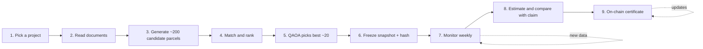

# Quantum-Enhanced Public Carbon Credit Verification

A public, independently checkable way to see whether a forest protection (REDD+) carbon credit project is delivering the impact it claims.

The repository finds "twin forests" to a reference project: unprotected land that looks like the project area before the project started. It then uses quantum optimisation to choose the best comparison set, measures forest loss in the project and in that set over time, and estimates what would have happened without the project.

> **Status:** early prototype built for the Hanken Quantum Hackathon. Candidate search exists in code. QAOA selection, monitoring, estimation and the on-chain certificate are designed but not built. Sections below say which is which.

## Contents

1. [The problem](#the-problem)
2. [The idea](#the-idea)
3. [Pipeline](#pipeline)
4. [How the pieces work](#how-the-pieces-work)
5. [Quantum results and an honest assessment](#quantum-results-and-an-honest-assessment)
6. [NFT status](#nft-status)
7. [Design principles](#design-principles)
8. [Open research questions](#open-research-questions)
9. [Current status](#current-status)
10. [Running the code](#running-the-code)
11. [Limitations](#limitations)
12. [Roadmap](#roadmap)

## The problem

Satellite-based rating platforms such as Sylvera, Pachama and BeZero already monitor carbon credit projects, and Verra now sets REDD+ baselines itself (methodology VM0048). What is still missing is a public record. A project's current status sits inside paid dashboards, and a company can choose not to share an unfavorable result.

## The idea

- Compare a registered project against similar, unprotected land nearby, using real satellite data.
- Use quantum computing to select the best comparison parcels and estimate what would have happened without the project.
- Publish the result as an on-chain certificate (NFT) that updates as new satellite data arrives, so anyone can check it.

The comparison land is required, not optional. Avoided deforestation only has meaning relative to what would have happened anyway, so a project's claimed impact cannot be checked without a stand-in for that hypothetical.

The core test is simple. If the comparison parcels lose forest and the project does not, the project is likely protecting it. If both lose about the same, it is not.

## Pipeline



| Step | What it does | Status |
| --- | --- | --- |
| 1. Pick a project | Take a registered project's boundary and claimed impact | Manual (KML file) |
| 2. Read documents | AI extracts the claimed baseline and tonnage from public project documents | Not built |
| 3. Generate candidates | Create comparison parcels around the project, with a buffer zone excluded to limit leakage | Built (grid of cells, 10 km leakage buffer, protected areas excluded) |
| 4. Match | Rank candidates by similarity to the project, using only information the outcome could not have influenced | Partly built (see [limitations](#limitations)) |
| 5. Select | Quantum optimization (QAOA) picks the best set of parcels, balancing similarity and geographic spread | Built. The full 50-of-200 selection is solved with classical methods; QAOA runs on a small 8-parcel version on a real IBM device (see [Quantum results](#quantum-results-and-an-honest-assessment)) |
| 6. Freeze | Save the chosen parcels and settings as a hashed snapshot so they cannot be swapped later | Built (`src/snapshot.py`, local SHA-256; publishing the hash is what would make it binding) |
| 7. Measure | Satellite forest loss for the project and the chosen parcels since project start, monitored weekly | Built (`src/monitor.py`, RADD radar alerts, from 2020 by default; see [Monitoring](#monitoring)) |
| 8. Estimate | Quantum amplitude estimation gives the expected loss without the project, with a confidence interval; convert to tons of CO2 and compare with the project's claim | Not built. A simulated QAE demo shows the theoretical speedup (see [Quantum results](#quantum-results-and-an-honest-assessment)) |
| 9. Certificate | Record the result on-chain, publicly and permanently | Built as a status NFT on Base Sepolia (`src/publish_nft.py`, see [NFT status](#nft-status)); token 0 was minted on 2026-10-09 with status Worst |

## How the pieces work

### Data

All geospatial data comes from Google Earth Engine.

| Layer | Dataset | Used for |
| --- | --- | --- |
| Tree cover, year 2000 | Hansen Global Forest Change (`UMD/hansen/global_forest_change_2025_v1_13`, band `treecover2000`) | Biomass proxy for matching |
| Forest loss year | Hansen Global Forest Change, band `lossyear` | Deforestation history and annual loss measurement |
| Elevation | SRTM (`USGS/SRTMGL1_003`) | Matching (current code) |
| Satellite embeddings | An Earth Engine satellite embedding dataset (64 numbers per location) | Matching (planned) |
| Road and nighttime-light accessibility | Road and nighttime-light layers (datasets not yet chosen) | Matching (planned) |
| Near-real-time alerts | RADD radar forest-disturbance alerts (`projects/radar-wur/raddalert/v1`, South America tiles, confirmed class, 10 m) | Weekly monitoring |

Hansen data updates about once a year, so it is the reference record. Alert layers update more often but are noisier, so they act as provisional early signals.

The current code matches on forest cover at the start year, pre-start loss and recent trend, elevation, slope, and distance to forest edge, water and roads. The planned feature set replaces these with the satellite embedding plus road and nighttime-light accessibility. All features must describe the land as it was before the project started.

### Candidate generation and matching (`parcel_finder.py`)

`FindParcels` takes the project polygon and works in four stages:

1. **Search region.** A ring around the project: the project buffered by 50 km, minus the project and a leakage buffer (10 km by default, `buffer_m`). Cells that touch a protected area are dropped too.
2. **Grid.** The ring and the project are covered with square grid cells (2 km by default, `cell_size_m`), and each feature is averaged inside every cell. Cells with less than half forest are dropped.
3. **Score.** Each candidate is compared with its `n_nearest` (default 3) closest cells of the project itself, so river-side and inland parts of a large project can both find analogues. Each feature gap is divided by that feature's spread across the candidates, the gaps are combined as a root mean square distance `d`, and `similarity = 1 / (1 + d)`.
4. **Select.** Greedy coverage: each pick is the candidate that gives the most project cells a better analogue, so unusual parts of the project are not left without one. Picks keep a minimum spacing (`min_spacing_km`). Places left over are filled with the best-scoring cells.

`ring_loss_report()` prints forest-loss rates in rings around the project before and after the start year, to help choose the leakage buffer. It uses post-start data for that choice only, never for matching.

### QAOA parcel selection (built; QAOA runs at small scale only)

Implemented in `src/select_parcels.py` (the QUBO and the classical solvers), `src/qaoa.py` (the QAOA circuit) and `src/qaoa_hardware.py` (runs on an IBM device). The design below is what the code follows. Results and limits are in [Quantum results](#quantum-results-and-an-honest-assessment).

Choosing which parcels to keep is a subset-selection problem. Give each of the N candidates a binary variable `x_i` (1 means the parcel is picked) and pick exactly `K` of them. The objective rewards parcels that match the target well and sets that are spread out geographically:

```
maximize:  (average z-scored match score of the picked parcels)
         + (average z-scored distance between every pair of picked parcels)

subject to: exactly K parcels picked
```

Written out, with `z(...)` meaning the z-score:

```
(1/K) * sum_i z(sim_i) * x_i  +  (1/(K(K-1)/2)) * sum_{i<j} z(dist_ij) * x_i * x_j
```

What each piece is:

- **Match score `sim_i`.** How similar candidate `i` is to the target, computed only from information the outcome could not have influenced. It is `1 / (1 + feature distance)`, so a perfect match scores 1. The planned features are the satellite embedding plus road and nighttime-light accessibility.
- **Distance `dist_ij`.** The real geographic distance in km between the centers of two picked parcels. This rewards a spread-out set instead of a cluster.
- **Z-scoring.** Each value is converted to how many standard deviations it sits above or below average. This puts match scores (between 0 and 1) and distances (tens to hundreds of km) on the same scale, so neither term wins just because its raw numbers are bigger.
- **Averaging.** The match term adds up `K` values, but the distance term adds up `K(K-1)/2` pairs. For `K = 6` that is 6 terms against 15, and the gap grows quickly with `K`. Dividing each term by its count keeps the balance fair for any `K`. Since `K` is fixed in advance, the divisors are constants, so the objective stays quadratic in `x` and can be handled by quantum optimization.

The objective is a QUBO (quadratic unconstrained binary optimisation) problem once the "exactly `K` picked" constraint is added as a penalty term. Each candidate needs one qubit, so the usable pool depends on the hardware. Current devices are small and noisy, so the pool will probably be pre-filtered classically (for example to the 30 to 60 most similar candidates) before the quantum run. The plan is to develop on a simulator, run on real hardware, and always compare against a classical baseline (greedy selection or simulated annealing) on the same objective.

Two things to watch when testing:

- **Equal weighting is an assumption.** One standard deviation of match quality currently counts as much as one standard deviation of spread. That is a stated choice rather than a measured value (see [Moran's I](#morans-i-as-a-weight-on-the-distance-term-optional)).
- **Pure spread can push picks to the edge.** Rewarding raw distance without a cap may favour parcels at the far edge of the search region, which are less comparable to the project. Check where the chosen parcels land relative to the project.

### Monitoring

Built in `src/snapshot.py` and `src/monitor.py`. Run `python src/snapshot.py` once after the selection to freeze the chosen parcels, the project cells, the settings and the boundary file's hash into `outputs/<project>/snapshot.json`. It refuses to overwrite an existing snapshot without `--force`, and `python src/snapshot.py --verify` checks it later. `python src/monitor.py` then:

1. loads the snapshot and stops if its hash no longer matches;
2. downloads weekly RADD radar alerts (confirmed class, 10 m) for each comparison parcel and for the project itself, measured inside its exact boundary against the forest inside it at the start (Hansen canopy of at least 30%); the project's grid cells are only used for the map. Losses are counted from the later of 2020-01-01 (the start of RADD alerts) and the project start (`--since` changes it);
3. computes cumulative loss rates and the avoided loss `(mean parcel rate - project rate) x project forest area`, with a bootstrap interval over the parcels.;
4. every 4 weeks (`--qae-every`) also runs a Monte Carlo and a simulated quantum amplitude estimate of the mean parcel loss rate with the same number of evaluations, and shows them next to the bootstrap;
5. converts to tons of CO2e and compares with the claim, pro-rated over the monitored window. The claim (1,004,626 tCO2e per year, 14 December 2017 to 2047) and the dates are the team's project facts (`PROJECT_START`, `PROJECT_END`, `CLAIMED_TCO2E_PER_YEAR` in `monitor.py`; check them against the project documents). The carbon density is derived from the project's own projection of 82,994.27 ha of avoided deforestation equal to 30,138,794 tCO2e over 30 years: 363.1 tCO2e per hectare, or 99.0 tC per hectare (`CARBON_TCO2E_PER_HA`). It is implied by the project's estimate, not measured here, and may already be net of deductions;
6. writes `outputs/<project>/monitoring_log.csv` (one row per week), appends a run record (time, snapshot hash, latest week, estimate) to `outputs/monitoring_runs.csv`, and rebuilds `outputs/monitoring_dashboard.html` from the template `src/monitor_dashboard.html`.

The dashboard map draws the project boundary in red over the grid squares, the 10 km leakage buffer in yellow, and can also show the 50 km search limit and the protected areas near the project (downloaded from Earth Engine the first time the dashboard is built for a project and cached in `outputs/<project>/protected_areas.geojson`; the menu entry shows how many there are, or that there are none); a layer menu on the map switches each of these, the grid cells and the comparison parcels on and off. The boundary and zones are lightly simplified for the page. The newest 8 weeks are marked provisional because alerts are confirmed with a delay. A weekly schedule on Windows is one `schtasks` command (see the header of `monitor.py`). Replacing provisional alert rows with the annual Hansen data is not built.

**Reading the estimator comparison.** The bootstrap interval shows how much the answer depends on which parcels were chosen, which is the real uncertainty. The Monte Carlo and QAE intervals show only the numerical error of computing the mean by sampling with a fixed number of evaluations; exact averaging has none. At 26,200 evaluations the simulated QAE is about 11 times tighter than Monte Carlo, consistent with the quadratic speedup, but it narrows a number that was never the bottleneck. The quantum part is a noiseless simulation, not a hardware run.

### Estimation and certificate (design, not yet implemented)

Avoided loss is estimated as the average parcel loss rate minus the project loss rate, times the project's starting forest area:

$$
\text{avoided loss} = \left(\bar{r}_{\text{parcels}} - r_{\text{project}}\right) \times A_{\text{project}}
$$

The spread across parcels gives an uncertainty range, first by resampling and possibly later by quantum amplitude estimation (QAE). With the current design resampling is cheaper and just as good, so QAE is a theoretical option, not a need; the conditions under which it pays off are in [Quantum results](#quantum-results-and-an-honest-assessment). The result is converted to tons of CO2 and shown next to the project's claim. The certificate stores the snapshot hash, the latest estimate with its range, and the claim, and updates when new results are published.

## Quantum results and an honest assessment

**Summary.** The selection step is written as a QUBO that quantum hardware can accept, and QAOA was run on a real 156-qubit IBM device (`ibm_fez`) on one 8-parcel version (a favourable problem, see below). It found the optimal set far more often than chance. Classical methods solve the same problem exactly and instantly, and the full problem is far too deep for today's hardware, so the project does not currently need quantum computing. The value of the quantum work is a validated formulation, a real-hardware run, an honest benchmark against classical methods, and a measured account of what hardware would have to improve. Nothing here claims a quantum advantage.

### What the classical solvers do on the real problem

The full problem (pick 50 of 200 candidates, `src/select_parcels.py`) is solved in seconds. Greedy selection with swaps and simulated annealing agree closely, and both are much better than taking the 50 most similar candidates. Picking 20 of 100 takes about 0.06 s for greedy and 0.07 s to 4 s for simulated annealing (short or full schedule), with costs within 1% of each other. An exact search is impossible there (about 5 x 10^20 possible sets), so these are very likely, but not provably, near-optimal. A pick of 50 of 200 matches the project's feature averages more closely than 20 of 100, while 20 of 100 has more similar individual parcels. Settings are at the top of `src/select_parcels.py`.

### QAOA on a real IBM device

`src/qaoa_hardware.py` picks 3 of 8 parcels (8 qubits, 2 layers, 275 to 340 two-qubit gates after routing). The angles are tuned on a perfect simulator. The 8 parcels are a random draw from the pool, not the final selection.

**Read this first.** The hardware run below was made on the 8-parcel problem built from the earlier candidates (project start year 2015, before the real start date was entered). On that one problem the perfect simulator found the optimal set every time. After the candidates were rebuilt with the real start year (2017), the same script builds a different 8-parcel problem, and on it, and on 10 random 8-parcel draws from the current data, 2-layer QAOA found the optimal set with a probability above 0.5 in none of them even in a perfect, noise-free simulation (3 layers: still none; the best single instance reached 0.26). The hardware result is therefore a single favourable problem, not typical performance, and it has not been repeated on the current data. The saved result file of the real run was overwritten by a later simulator run, so the figures below come from the terminal output of the real run (jobs `db3s9m84qg6s73c19s00` for the first single run, and `db3t502mb58s7388bjfg`, `db3t7904qg6s73c1asc0`, `db3t7bo4qg6s73c1asi0`, `db3t7f2mb58s7388bm2g`, `db3t7isvf2bc73ctoj30`, `db3t7lqmb58s7388bmbg` for the six runs in the table).

Results on `ibm_fez` (3 jobs per method, 4,000 shots each, 33 s of QPU time in total; run to run spread was about 1 to 2 points):

| Method | Shots with exactly 3 parcels | Optimal set among valid shots |
| --- | --- | --- |
| Raw counts | 46% | 68.5% |
| Raw + readout-error correction | 48% | 70.8% |
| Raw + readout correction + keep only valid answers | 100% (after discarding the rest) | **70.8%** |
| With IBM error suppression (dynamical decoupling and twirling) | 35% | 52% |
| Random 3-set | n/a | 1.8% |

- The optimal set appeared in about 31% of all raw shots, against 0.4% for random bitstrings. Among valid answers it is about 39 times better than a random 3-set.
- IBM's built-in error suppression made the result worse for this circuit (18% against 31% of all shots). The cause was not isolated; one possibility is that the extra pulses and randomised gates add more error than they remove on a circuit where qubits rarely idle.
- Two thirds of raw shots return the wrong number of parcels, which shows how much noise the circuit picks up.

### Benchmark against classical methods (`src/benchmark.py`)

On the same 8-parcel problem, exact search, greedy and simulated annealing all find the optimum every time, in 0.1 to 100 ms. Random search with the same 4,000-sample budget also finds it every time, because only 56 sets exist. QAOA on the chip finds it too, but takes about 5 s of QPU time per job (queueing not included). QAOA is better than random per attempt but not competitive with the classical methods. At this size it cannot be.

### Why the full problem does not run on hardware

The cost couples every pair of parcels, so the circuit grows with the square of the problem size, and routing onto the chip's limited connections adds more. Compiled for a 156-qubit chip with 2 QAOA layers:

| Qubits | Pick | Two-qubit gates | Chance of no gate error at 0.3% | Gate error for 50% success |
| --- | --- | --- | --- | --- |
| 8 | 3 | 339 | 36% | 0.20% |
| 16 | 3 | 1,372 | 1.6% | 0.05% |
| 32 | 6 | 5,160 | 2 x 10^-7 | 0.013% |
| 64 | 12 | 21,484 | 10^-28 | 0.003% |
| 100 | 20 | 51,034 | 10^-67 | 0.0014% |

Running 20 of 100 would need two-qubit gates roughly 200 times more accurate than today's, and 200 candidates would not fit on the chip. Angle tuning on a simulator also stops at about 20 qubits. Gate errors of about 0.3% are normal for current superconducting devices and are the main reason for the limit.

### Amplitude estimation (`src/amplitude_estimation.py`)

Quantum amplitude estimation has a proven quadratic speedup for estimating an average: error e needs about 1/e evaluations instead of about 1/e^2. Unlike QAOA, this is a theoretical result, not a heuristic. The script builds the real circuit for the average recent loss rate of the 50 selected parcels, simulates it exactly, and compares it with Monte Carlo at the same number of evaluations.

| Evaluations | Monte Carlo | QAE, perfect gates | QAE, 10x better than today | QAE, today (0.3% gate error) |
| --- | --- | --- | --- | --- |
| 1,800 | 7.1% | 3.1% | 7.0% | 33% |
| 26,200 | 1.8% | 0.22% | 2.9% | 33% |

- With perfect gates the error falls at a log-log slope of -0.88, close to the ideal -1, against -0.51 for Monte Carlo.
- At today's gate error QAE is worse than Monte Carlo, and 10x better gates only roughly match it. The advantage needs error-corrected hardware.
- For +/-1% on the mean, Monte Carlo needs about 98,000 evaluations and QAE about 2,000. The deepest QAE circuit would need gate errors around 10^-6, about 3,000 times better than today (approximate constants).

**When QAE would pay off.** With all 50 parcel values in hand, their average is one line of code and no sampling is needed. QAE helps only if the estimate is an average over something expensive to sample, for example a stochastic deforestation model run over the project's pixels, with uncertainty in the matching, the loss rates and the spatial spread. Then each evaluation costs real compute time, and the saving is about 20,000 model evaluations instead of 10 million for 0.1% precision. This is a proposed design, not something built or validated. Two cautions: the simulator would have to be written as a reversible quantum circuit, and loading it can cost more gates than the saving buys (our 50-parcel average compiles to only 105 gates, a realistic model would be far larger); and the hardware requirement above still applies.

### How to describe this

"Classical solvers already do the selection well. We wrote it as a quantum-ready optimisation problem, ran it on IBM's 156-qubit Fez processor, where on one 8-parcel problem it found the optimal 3-of-8 set about 71% of the time among valid answers (random: 1.8%); we also report that this problem was favourable, since on random 8-parcel problems from our current data QAOA does not find the optimum even in a perfect simulation; and benchmarked it honestly against classical methods, which win at every size we can run. Amplitude estimation has a proven quadratic speedup for the estimation step, which we show in simulation; today's 0.3% gate error removes it, and certification-grade precision would need gates roughly 3,000 times better."

## NFT status

The monitoring result is published to a status NFT (contract `0x386f0C26891AdAb4041AB547Dd59D5C8d7B2A492` on Base Sepolia, from the `qanopynft` repository). There are five statuses: Worst, Bad, Neutral (on track), Good and Best, set by how the measured avoided emissions compare with the claim pro-rated over the monitored window: below 50%, 50 to 90%, 90 to 110%, 110 to 150% and above 150%. At the latest run ALGAR is at about 31% of the claim to date, which is **Worst**, and Projeto Agroflorestal is at about 123% (**Good**, on an assumed carbon density). The published token for ALGAR was minted when the figure was 28%; republish to update it. The dashboard shows the status and, once published, the token and transaction.

`python src/publish_nft.py` is a dry run; `--publish` uploads the metadata to IPFS through Pinata and mints the token the first time, then updates the same token. Credentials are read from the `.env` file in the repository root (git ignores it) or from environment variables, never from code: the contract owner's private key (`PRIVATE_KEY`), the RPC endpoint (`SEPOLIA_RPC`) and Pinata (`PINATA_JWT`, or `PINATA_API_KEY` with `PINATA_SECRET`). `--inline` skips Pinata and stores the metadata inside the token URI (a larger transaction, about 1.4 million gas against about 185,000). `python src/run_pipeline.py` runs the whole pipeline with publishing as the last step (see Running the code). Details are in `nft/README.md`. Things to know:

- The status rests on an estimate with wide uncertainty, and the measured value is well below the claim largely because of the limitations listed below (matching, missing 2018 and 2019, a few high-loss parcels), so Worst is not a finding about the project. The 50% to 150% bands are a choice and are not validated.
- The newest weeks are provisional, so the status can change between runs.
- The first publish ran on 2026-10-09: token 0 was minted on Base Sepolia with the status Worst (transaction `0xe744cb4e38b27db3d748fe9a89b813600c5fcc09a45b9c0f5d609000f0e0e9cb`, metadata `ipfs://QmRNSG4Toe9nYr5MyVD46whjnM7sDxJfEXg8mfG3nptKrC`, pinned on Pinata and read back through a gateway). Basescan read the metadata (name, all 15 properties, description) but showed no image for the token. The image links themselves work (the five images are normal JPEGs of about 460 by 470 px, served by Pinata's gateway, and announced by several IPFS providers), so the first update (transaction `0x431548ca835963ca406e094c5eddb093912f6a544f2eba312aa71fa0bccb14a4`, new metadata `ipfs://QmNxnGeg7CzQg3bpYFPF2xTyHbDyxtpQSxh7nfrHWERXZ4`) changed the metadata's `image` from the `ipfs://` link to the HTTPS gateway URL `https://gateway.pinata.cloud/ipfs/<cid>` and kept the `ipfs://` link as `image_ipfs`. About four minutes later Basescan still showed its placeholder; whether that is a cache that needs a metadata refresh, or the explorer not rendering testnet images, was not established. Later publishes update token 0 with `changeTokenURI`, which has now been run once on-chain. Projeto Agroflorestal was published too: token 1 was minted on 2026-10-09 with the status Good (transaction `0xe618bd53da4d9e8452f1fb10105299860655373a6e3b553f14c96155d5903f60`, metadata `ipfs://QmRy44K5RQw6jP9tygvrQ3eZnQibuoE3BtKiDXAWftHfcp`). That status rests on an assumed carbon density (550 tCO2e per hectare), which the token's description and its `Carbon density source` property state; with a different density it could be Bad, Neutral or Best. Lomphat Wildlife Sanctuary was published as token 2 (status Worst, 8% of the claim to date, on an assumed 550 tCO2e per hectare, with the weak-comparison caveats above; transaction `0xfe37d8e8be263404ab4f6c182ee6138282fd76c1e5a24e61ab730cf42d893774`, metadata `ipfs://QmTpoc8W86dRUrcPr86XEvWec8BXnqdRqsusTREeTnTJVS`). Basescan reads the properties of both tokens but shows its placeholder instead of the image, even for the token whose metadata used an HTTPS image from the start, so this looks like a limitation of the testnet explorer, not of the images.

## Design principles

- **No circularity.** Parcels are matched on traits fixed before the outcome period, never on the outcome itself.
- **Leakage buffer.** Land next to the project is excluded, since deforestation pressure can shift there.
- **Spread-out comparison set.** Selected parcels should be far enough apart to count as independent evidence.
- **Scaled objective.** Similarity and distance are z-scored and averaged so that neither term dominates as the number of selected parcels grows.
- **Frozen controls.** The chosen parcels are saved with a hash before monitoring starts, so they cannot be swapped for more convenient ones later.
- **Provisional versus certified.** Weekly alerts are early signals; only the annual data backs a certified number.

## Open research questions

### Optional upgrades considered, not built first

Two methods were considered for the objective. The version settled on is z-scoring and averaging (above); both methods below are optional upgrades that are **not planned for the first build and have not been tested**.

#### Mahalanobis distance in the match score (not planned)

It would replace the way feature distance is measured inside the match score. Unlike plain Euclidean distance, it accounts for features that move together, so correlated features are not counted twice. The caution is sample size: embeddings have 64 numbers per location, and with a few dozen candidates the correlation structure cannot be estimated reliably. For embeddings, plain Euclidean or cosine distance is the safer choice, so Mahalanobis distance is not planned.

#### Moran's I as a weight on the distance term (optional)

Moran's I measures how strongly nearby land behaves alike in the data. It would set a weight `w` on the distance term:

```
average z(match) + w * average z(distance)
```

High Moran's I means clustering gives redundant evidence, so diversity should count more. Right now `w` is implicitly 1. If Moran's I is added later, compute it on pre-project data only, to stay consistent with the no-circularity principle.

### Other open decisions

- Size of the leakage buffer around the project (currently 5 km) and of the candidate parcels (currently 2 km cells; the project is about 146,000 ha, so 16 ha cells were too small to give stable loss rates).
- Canopy percentage that counts as forest.
- Which alert dataset to use, and whether it covers the target region at the confidence level needed.
- Source of carbon-per-hectare values for converting hectares to tons of CO2.
- Which quantum device runs QAOA, with what qubit count and connectivity, and how large the pre-filtered pool can be.
- Which blockchain hosts the certificate, and what is stored on-chain versus off-chain.
- The first real test project, with its start date, boundary file and claimed baseline.

## Repository layout

```
data/            input files (one boundary KML per project)
src/             all code: finder, QAOA, selection, the stage map, monitoring
outputs/<project>/   everything generated for one project (snapshot and NFT state are tracked by git)
outputs/monitoring_dashboard.html   the one dashboard page, with a tab per project
```

Run every script from the repository root, e.g. `python src/example.py`.

### Several projects

Projects are plain data in `data/projects.json` (`algar`, `agroflorestal` and `lomphat` so far), so a new project needs no code. Every script works on one project, chosen with `--project`, and the default is `algar`. The easiest way is the interactive prompt: run `python src/add_project.py` with no arguments, choose the boundary file, paste the Verra overview text (it reads the area, dates and annual claim out of it) or type the values, pick how the carbon density is set, and say whether to publish the NFT. It checks the project, then runs the whole pipeline and, if you chose, publishes the result. The same thing as one command:

```bash
python src/add_project.py lomphat --name "Lomphat Wildlife Sanctuary REDD+" --kml LWS_boundary.kml \
    --start 2023-05-03 --end 2063-05-02 --claim 690039 --registered-ha 134730 \
    --carbon-tc-per-ha 150 --run --publish
```

`--claim` is the projected average avoided emissions per year (tCO2e). For tCO2e figures and an NFT status give a carbon density: `--carbon-tc-per-ha` (an assumption, tons of carbon per hectare) or `--projected-ha` together with `--projected-tco2e` (the project's own projection, from which the density is derived). Without one the project shows hectares only. `--run` then runs the whole pipeline (candidate search, selection, snapshot, monitoring), and `--publish` adds the NFT at the end; without `--run` it prints the command to run later.

**From the dashboard:** start the local server with `python src/dashboard_server.py` and open the address it prints (http://127.0.0.1:8765). The dashboard there has an **Add project** button. The form takes the boundary `.kml`, the project's facts (or the pasted Verra overview, which fills them in), the carbon density option and whether to publish the NFT. **Check only** runs the checks and adds nothing; **Add and run** adds the project, runs the whole pipeline and shows its output live. A run continues if you close the window, and when it finishes, reload the page and the project has its own tab. A dashboard opened as a plain file still works for viewing, but cannot run anything, and the button says so. The server only listens on this computer, only accepts requests that carry a random token it put into the page, runs one project at a time, and uses the keys in `.env` for publishing, which the browser never sees. Publishing needs a ticked box and a confirmation.

Before adding anything the command checks what would otherwise fail later, and stops with the reason (`--force` overrides): the boundary file (area against `--registered-ha`, number of parts, and whether at least 10 of the 2 km grid cells lie mostly inside it, which a boundary of thin fragments does not), that the boundary area is plausible (it is refused when it is more than 3 times larger or smaller than `--registered-ha`, which usually means a reference region or project zone was uploaded instead of the project area, or when it is above 1,000,000 ha), that RADD alerts exist at the place and which regional tile set covers it (`sa`, `africa`, `asia` or `ca`, detected automatically), and how much of the area counts as forest at the 30% canopy threshold (open woodland has too little to measure). A KML with several layers (folders) is read in full: when the registered area matches one layer that layer is used (`--kml-layer` picks one by name, and the choice is stored as `kml_layer`), otherwise all layers together. Very detailed boundaries (above 20,000 points) are simplified before being sent to Earth Engine, which rejects large requests. The pipeline itself adapts: the comparison search starts at 50 km and widens to 100 and 150 km until at least 100 parcels are found (a fixed `--search-radius-km` is used as given), and the selection never picks more than 40% of the pool, so a small pool cannot make it fail.

Each project's results go to `outputs/<project>/`, and the dashboard page collects every project that has monitoring results into tabs. A project without a carbon density still runs and shows hectares, but has no tCO2e figures and no NFT status. Each project gets its own NFT token on the same contract, minted the first time it is published.

The second project is Projeto Agroflorestal (Agroflorestal Novo Horizonte REDD+ AUD, Verra 5295, Prainha, Pará, Brazil): 23,093 ha registered, started 10 October 2021, crediting period to 9 October 2061, estimated average annual reductions of 94,143 tCO2e (the Verra overview figure, the average achieved in the first monitoring period; the description also gives a projected 79,648 tCO2e per year, selectable in `data/projects.json`). Its boundary file matches the registered area (23,103 ha, 92 polygons, repaired because the file contains self-intersections). Neither the overview nor the description gives the projected avoided hectares, so the carbon density cannot be derived the way it was for ALGAR. It uses an **assumption** of 550 tCO2e per hectare (about 150 tC per hectare, a typical value for Amazon forest, not from this project), which the dashboard and the NFT metadata state; replace it in `config.py` once the project's projected avoided hectares are known. The status depends strongly on it: against the claim over the window the status is Bad below about 400 tCO2e per hectare, Neutral from about 400 to 490, Good from about 490 to 670 and Best above that. Monitoring counts losses from the project start (October 2021), not from 2020. The project's loss is measured inside its exact boundary (22,855 ha of forest at the start); an earlier version measured it in the 27 grid cells that are at least 90% inside the boundary, which cover only 47% of the project, and gave an avoided loss of about 480 ha instead of the current figure. In the run to September 2026 the comparison parcels lost about 5.1% of their forest and the project 0.5%, an avoided loss of about 1,040 ha (bootstrap 95% interval 327 to 2,104 ha), about 570,000 tCO2e at the assumed density, 123% of the claim over the window, which is **Good**. Caveats: the ring test shows deforestation around the project rising after the start (about 1.4 to 2.5 times higher in every ring), so background pressure rose everywhere; the distance-to-road feature is capped at 50 km for this remote project and does not discriminate; and 181 of the 200 wanted comparison parcels met the spacing rule. The third project is the Lomphat Wildlife Sanctuary REDD+ project (Verra 3434, Cambodia): 134,730 ha registered, started 3 May 2023, crediting period to 2 May 2063, estimated average annual reductions of 690,039 tCO2e. Its boundary file holds forest-type polygons (125,953 ha with 4,595 holes cut out, 130,920 ha of outer area), uses RADD's Asia alert tiles (`radd_geography` in `config.py`) and needed a wider comparison search of 100 km (`search_radius_m`), because within 50 km only 230 cells were eligible: the surroundings are mostly protected, and protected land is correctly excluded. It has no carbon density, so there is no tCO2e figure and no NFT status. The forest there is dry and open, so only 37% of the area (49,100 ha) counts as forest at the 30% canopy threshold, and the dashboard warns that this differs from the registered area. In the run to the end of August 2026 the comparison parcels lost 0.68% of their forest and the project 0.015%, an avoided loss of about 325 ha (bootstrap 95% interval 68 to 692 ha). **The comparison is weak and this should not be read as a protection effect:** before the start the parcels already lost forest about 12 times faster than the project (0.37% against 0.03% a year), they had about five times more older loss (3.2% against 0.6%), they match poorly on distance to water (about 1.4 standard deviations off), 39 of the 50 parcels lost nothing, and only 10 lost more than the project. A first Tumaco project (Verra 1389) was tried and dropped: its boundary is made of 22,902 thin fragments, so no 2 km cell is 90% inside it and the finder cannot build project cells.

## Current status

| File | Purpose |
| --- | --- |
| `src/dashboard_server.py` | Serves the dashboard locally with an **Add project** button: upload a boundary, enter the facts, and it runs the checks and the pipeline (and the NFT, if chosen) with live progress |
| `src/add_project.py` | Adds a project to `data/projects.json` from its boundary file and Verra facts, after checking the boundary, alert coverage and forest cover; `--run` runs the pipeline, `--publish` adds the NFT |
| `src/config.py` | Shared settings and file locations: reads the projects in `data/projects.json`, cell size, buffer, Earth Engine project, output paths |
| `src/geo.py` | Shared helpers: read the project boundary, grid squares, start Earth Engine |
| `src/parcel_finder.py` | `FindParcels` class: builds the search ring, scores grid cells against the project's own cells, selects well-spaced candidates |
| `src/example.py` | Runs `FindParcels` on a KML boundary, prints a quality report, writes `candidates.csv`, `project_cells.csv` and `project_profile.json` |
| `src/select_parcels.py` | Builds the QUBO for choosing K parcels from the candidates, solves it classically and (optionally) with QAOA, writes `selected_parcels.csv` and `selected_matches.csv` |
| `src/qaoa.py` | QAOA solver (Qiskit) used by `select_parcels.py` |
| `src/qaoa_hardware.py` | Runs a small QAOA problem (8 qubits) on a noisy IBM chip simulation, or on a real IBM device with `--ibm`, and compares it with the perfect simulation |
| `src/benchmark.py` | Compares the saved QAOA hardware run with exact, greedy, annealing and random search on the same problem, and shows how the circuit grows with problem size |
| `src/amplitude_estimation.py` | Quantum amplitude estimation of the comparison set's mean loss, simulated exactly and compared with Monte Carlo, with and without gate noise; shows the quadratic speedup in theory and why it needs error-corrected hardware |
| `src/snapshot.py` | Freezes the selected parcels, project cells and settings into `outputs/<project>/snapshot.json` with a SHA-256 hash, and verifies it |
| `src/monitor.py` | Weekly monitoring: downloads RADD alerts for the project and the frozen parcels, estimates avoided loss with a bootstrap, Monte Carlo and simulated QAE, writes a log and `outputs/monitoring_dashboard.html` (template: `src/monitor_dashboard.html`) |
| `src/nft_status.py` | The five NFT statuses, their bands against the claim, and the NFT metadata (no network access) |
| `src/run_pipeline.py` | Runs the pipeline in order (search, select, snapshot, monitor, publish) from one command; publishing only happens with `--publish` |
| `src/publish_nft.py` | Dry run by default; with `--publish` pins the metadata to IPFS via Pinata and mints or updates the NFT on Base Sepolia |
| `nft/` | Copy of the contract source, its ABI, and notes on the contract, statuses and images (from the `qanopynft` repository) |
| `src/selection_map.py` | One interactive map with a button per stage (project, forest data, leakage buffer, protected areas, search region, candidates, pool, QAOA test problem, selected parcels, matches), saved as `outputs/selection_map.html`. Forest layers and protected areas need an Earth Engine login; protected areas are then cached in `outputs/<project>/protected_areas.geojson` |

The candidate search matches only on information from before the project start year, on deforestation drivers (forest at start, pre-start loss and trend, elevation, slope, distance to forest edge, water and roads), with features scaled by their spread across the pool. Protected areas are excluded. The 50-of-200 selection (classical solvers, plus QAOA at 8 qubits on IBM hardware), the staged map, a classical benchmark and a simulated amplitude-estimation demo are built. The frozen snapshot, weekly alert monitoring and a first avoided-loss estimate (with placeholder carbon and claim values) are also built. Not yet implemented: annual-data replacement of provisional rows, a real CO2 conversion, and the certificate. The Earth Engine parts were written without being run against Earth Engine; test before relying on them.

## Running the code

Requirements: Python 3, a Google account registered for Earth Engine, and a Google Cloud project with the Earth Engine API enabled.

```bash
pip install -r requirements.txt
```

1. Put the project boundary (a KML file containing one polygon) in `data/` and add the project with `python src/add_project.py` (see Several projects above). The ALGAR boundary is in the repository.
2. Initialise Earth Engine with your Cloud project ID, for example `ee.Initialize(project='your-project-id')`. The first run of `ee.Authenticate()` opens a browser window to log in.
3. Run:

```bash
python src/example.py
```

It prints a short quality report and saves the result files in `outputs/<project>/`. Earth Engine work runs on Google's servers, so large search areas can take a while or hit usage limits.

Then, from the repository root:

```bash
python src/select_parcels.py     # pick K parcels (classical + small QAOA on a simulator)
python src/selection_map.py      # staged map: outputs/<project>/selection_map.html
python src/qaoa_hardware.py      # noisy simulation of a 156-qubit IBM chip, no account needed
python src/benchmark.py          # QAOA run against classical methods, plus circuit growth
python src/amplitude_estimation.py   # simulated amplitude estimation, prints and plots the scaling
python src/snapshot.py           # freeze the selected parcels (once; --verify to check)
python src/monitor.py            # weekly: download alerts, update the log, open the dashboard
python src/publish_nft.py        # dry run of publishing the status NFT (--publish needs keys, see nft/README.md)
python src/run_pipeline.py       # the weekly pipeline in one command: monitor, then a dry run of the NFT publish
python src/run_pipeline.py --publish   # ...and publish the status (a public transaction)
python src/run_pipeline.py --full      # first run: also candidate search, selection and snapshot
```

`monitor.py` needs an Earth Engine login for the download and takes a few minutes; `--offline` reuses the last download. Run it again each week, or schedule it.

To run QAOA on a real IBM device, save your IBM Quantum credentials once with `QiskitRuntimeService.save_account(...)` (see the header of `src/qaoa_hardware.py`; keep the API key out of the repository), then run `python src/qaoa_hardware.py --ibm --backend ibm_fez --repeats 3`. This uses QPU time on your plan (about 5 s per job in the run above). `--no-compare` skips the runs without error suppression.

## Limitations

- **Matching does not see frontier exposure.** Before the start year, forest loss was similar everywhere within 30 km, but after it, loss rose steeply with distance from the project. Matching on pre-start features cannot detect this, so far-away candidates may overstate the baseline loss. A pre-start frontier-exposure feature is planned.
- **Project start year.** The start year comes from each project's start date in `data/projects.json` (ALGAR started 14 December 2017, so 2017), so matching features use data up to 2016, which is conservative because most of 2017 is also before the start. Changing it changes the candidates, the selection and the result: moving from the earlier placeholder 2015 to 2017 raised the comparison parcels' loss from 2.9% to 4.6% of forest over the same window. The bootstrap interval does not capture this sensitivity to the parcel choice.
- **Feature caveats.** The roads layer (GRIP4) and protected-area layer are recent snapshots, so for an earlier start year they include information from after the start. Other carbon projects and indigenous land are not excluded.
- **Estimate, not proof.** Finding that similar land lost more forest than the project is evidence of protection, not proof. Factors that are not matched on could explain part of the difference, so results should be described as estimates.
- **Alerts are noisy.** They can include fire, degradation and cloud artefacts.
- **Quantum scale.** Current quantum hardware cannot run QAOA beyond about 8 to 10 qubits usefully, and cannot hold a 200-variable problem. On the sizes that fit, classical methods match or beat QAOA (see [Quantum results](#quantum-results-and-an-honest-assessment)), so the quantum part is a proof of concept, not a requirement.
- **Hardware results rest on one small problem.** The IBM run uses one 8-parcel draw, 3 jobs per method, and the angles were tuned on a perfect simulator. Results will differ across problems, devices and days.
- **Monitoring window and the first estimate (ALGAR).** RADD alerts in this area start in early 2020, and the monitoring window runs from 2020-01-01, so the first two years of the project (December 2017 to 2019) are not covered, and the claim is pro-rated over the monitored window only. In the run to mid-September 2026 the comparison parcels lost about 4.6% of their forest and the project 0.58% of its 142,318 ha of forest, an avoided loss of about 5,740 ha (bootstrap 95% interval 2,895 to 9,106 ha), or about 860 ha per year. At 363 tCO2e per hectare that is about 2.1 million tCO2e, about 31% of the claim pro-rated over the window (about 6.8 million tCO2e). The project's own projection is 82,994 ha over 30 years, about 2,770 ha per year, roughly 3.2 times the rate measured against the comparison parcels. The comparison does not reproduce the projection, but that is not a finding about the project: a few parcels with very large losses dominate the parcel average, the matching does not see frontier exposure (first limitation above), the window misses 2018 and 2019, and the projection may rest on assumptions not modelled here. Measuring inside the exact boundary instead of in grid cells raised this project's avoided loss by about 12% (the cells had covered 89% of its forest). Do not read any of it as a verified result.
- **Alerts are limited.** RADD flags disturbance in primary humid tropical forest only, at the confirmed class, and the newest weeks are provisional.
- **Amplitude estimation is simulated.** It has not run on hardware, and it only pays off if the estimate becomes an average over an expensive model, which is not the current design.

## Roadmap

- [x] Candidate search over a 50 km ring using Earth Engine
- [x] Fix runtime errors in `FindParcels` and default to 200 candidates
- [x] Match on pre-start data only, add a leakage buffer, protected-area exclusion and a spacing rule
- [x] Score candidates against the project's own grid cells and select by coverage
- [ ] Add a pre-start frontier-exposure feature, then a placebo test on pre-start years
- [ ] Switch matching to the planned features (satellite embedding plus road and nighttime-light accessibility)
- [x] Selection of K parcels using the match, balance and crowding objective, with classical baselines
- [x] QAOA on a small version of the selection, run on a real IBM device and benchmarked against classical methods
- [x] Simulated amplitude estimation with a noise model and a resource estimate
- [ ] Test whether error suppression helps on other circuits (dynamical decoupling and twirling separately)
- [ ] Optional: define the estimate as an average over a stochastic counterfactual model, the case where amplitude estimation pays off
- [ ] Optional later: Moran's I weight on the distance term
- [x] Frozen, hashed snapshot of the selected parcels
- [x] Weekly monitoring with RADD alerts, a bootstrap interval and a simulated QAE comparison
- [ ] Replace provisional alert rows with annual Hansen data
- [x] Project start date, duration, annual claim and the carbon density implied by the project's projection
- [ ] Monitoring of December 2017 to 2019 (annual Hansen data) so the whole project period is covered, and checking the implied carbon density against the project's carbon stock data
- [ ] Check whether the parcels' higher loss reflects frontier exposure and a few outliers (for example a placebo test on earlier years)
- [x] Status NFT (Base Sepolia) with five statuses, publisher, dashboard status and `run_pipeline.py`; token 0 minted
- [ ] Send a first update to the existing token, and decide how often to publish while the estimate is this uncertain